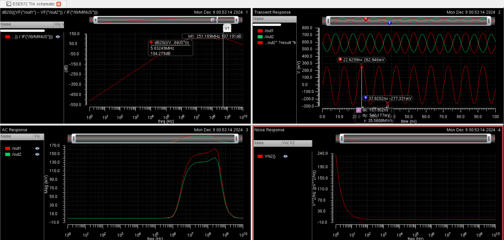
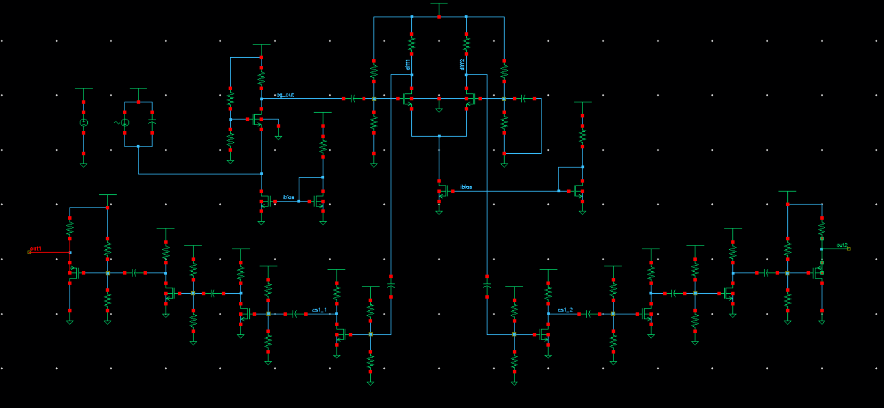
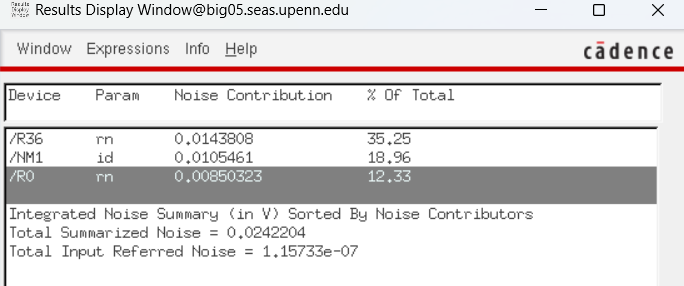

# Simulation Data

ESE 5720 Wideband Trans-Impedance Amplifier · Cadence captures

> Markdown version of [`ESE 572 data.docx`](ESE%20572%20data.docx) for reading on GitHub. The original Word file is in this repository.

**Simulation results: trans-impedance gain, transient output, AC response and input-referred noise**

**Final TIA schematic**

**Integrated noise summary**

